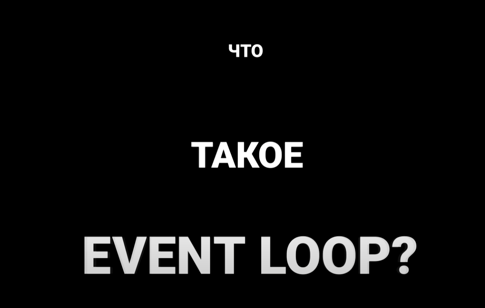
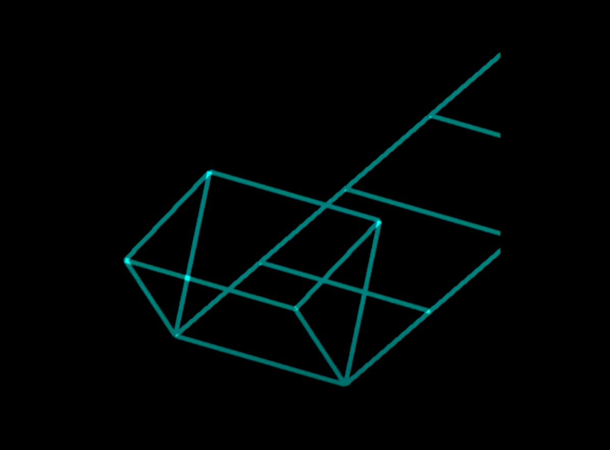
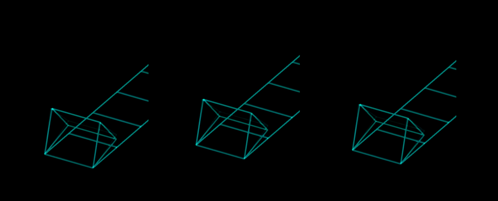
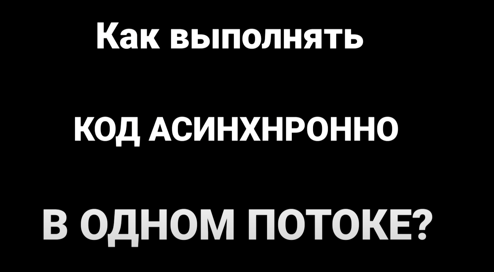

Что такое EventLoop в JavaScript?

JavaScript — это однопоточный язык программирования. Это означает, 
что в каждый момент времени может выполняться только одна задача.

Если задача ресурсоемкая, следующая задача не начнет выполняться, пока текущая не завершится. 
В этом есть свои плюсы и минусы.

Минусы:
+ Представьте, что пользователь нажимает на кнопку, и в этот момент запускается 
ресурсоемкая операция. В течение 5 секунд пользователь ждет, пока задача завершится, 
с заблокированным интерфейсом. 
+ Или другой пример: пользователь отправляет 
сообщение в чате. Пока сервер не вернет ответ, интерфейс остается зависшим.

Такая блокировка интерфейса — серьезный недостаток. 

Для сравнения, в других 
языках, таких как Java или C++, задачи могут выполняться параллельно, 
что позволяет избежать подобных проблем.

Код может выполняться в нескольких потоках, и этими потоками можно управлять вручную.

Если один поток занят трудоемкой задачей, 
другие процессы могут выполняться в параллельных потоках. 
Это позволяет программе продолжать работу без блокировки.

**Преимущества многопоточности:**
- Задачи, требующие значительных ресурсов, не мешают остальной программе реагировать на действия пользователя.

**Однако есть и сложности:**
1. Писать код для однопоточного JavaScript гораздо проще, чем для многопоточных языков, таких как Java.
2. Параллельные вычисления создают дополнительные проблемы, например, связанные с синхронизацией данных 
или состоянием программы. Эти нюансы требуют отдельного изучения и выходят за рамки текущего ролика.

Вернемся к однопоточному JavaScript.  
Представьте, что пользователь 
+ нажимает кнопку, 
+ отправляется запрос на сервер, 
+ и интерфейс зависает.

В таких случаях возникает логичный вопрос: как избежать блокировки интерфейса?

# Вопрос: Как в однопоточном JavaScript выполнять асинхронный код?

В этом помогает концепция **event loop**, или **цикл событий**.

- Есть `console.log`. Мы его выполняем.
- Идет следующая операция — `console.log`. Мы ее выполняем.
- Затем идет какая-то функция. Мы ее также выполняем.

Весь код синхронный.

- Затем идет асинхронная операция (например, запрос на сервер).
- Мы ее регистрируем и забываем про нее до получения ответа.
- Весь последующий код продолжает выполняться. Программа **не блокируется**.
- Как только приходит ответ, переданный callback **выполняется**.

Теперь усложним:

**Event loop**...

бесконечный цикл который ожидает задачи

выполняет их и затем снова ожидает

поступления новых задач начнем опять же

с простейшего случая когда все операции

синхронны и добавляем новое понятие как

стек вызовов

операции всегда попадают на вершину

стейка из этой же вершины они

выполняются рассмотрим на примере кода

из левого нижнего угла сначала

выполняется секунд function зачем

выполняется console.log 3 которые

находятся внутри этой функции и сразу же

уходит из стека затем туда попадает пёзд

фанкшн

выполняется console.log один сразу же

уходит из стека выполняется консоль лог

2

и сразу же уходит из стека затем first

function возвращает результат и уходит

из стека и затем c-cam фонтан возвращает

результат и уходит из стека

здесь все логично код выполняется в

синхронном режиме давайте усложним

добавим две синхронные операции это

во-первых сеть тайм-аут во вторых

слушатель нажатии на кнопку здесь помимо

стека вызовов у нас добавляется web api

которая как раз нам и предоставляет

такие функции как стать тайм-аут и

слушатели событий и появляется очередь

задача сейчас на примере посмотрим как

это все работает в первую очередь

выполняется console.log старт попадает

стык и сразу же оттуда уходит затем мы

получаем кнопку по ее айдишник у на этом

моменте мы вешаем слушатель события на

кнопку и web api этот слушатель

регистрирует затем выполняется функция

выполняется сайт тайм-аут и опять же

попадает web api сразу же запускается

счетчик но при этом код продолжает

выполняться выполняется console.log

внутри функции выполняется сама функция

и в заключении стек вызовов попадает

console.log

and на данный момент все должно быть

понятно все предельно логично но в этот

момент пользователь решает нажать на

кнопку стек вызовов у нас при этом еще

не пустой и функция которая должна

выполниться при нажатии на кнопку

попадает в очередь задач и находится там

до тех пор пока стек вызовов не станет

пустым сколько бы задача там не было

задачи из очереди ждут опустошение стека

в этот же момент у нас заканчивается

таймер и call back также попадает в

очередь задач из очереди в отличие от

стека первым выходит тот кто в эту

очередь попал и так задачи как говорится

ждут свои очередь а их очередь настанет

тогда когда стек вызовов

очиститься console.log оттуда уходит и

сразу же забирается первая задача из

очереди и попадает стек вызовов и затем

все начинается по кругу опять вызывается

функция тайм-аут попадает впп

запускается счетчик стек вызовов

очищается и из очереди забирается

следующая задача и отправляется в стек

вызовов и снова все по кругу сейчас в

очереди находится один call back

выполняется попадать так вызову оттуда

выполняется console.log

он уходит из т.к. и call back уходит из

т.к. на этот момент очередь пуста стек

пусть но есть один зарегистрированный

слушатель события нажатия на кнопку и до

тех пор пока пользователь на эту кнопку

не нажмет even клуб будет ожидать

поступления новых задач если на данном

моменте вам что то непонятно попробуйте

отмотать видео и пересмотреть эту

цепочку старался сделать объяснение

максимально простым и если материал из

этого видео вам был понятен советую

почитать про микро и макро задачи чтобы

не усложнять материал эти понятия в этот

ролики включать не стал

итак друзья не забываем поставить лайк

написать комментарий а я в свою очередь

жду вас в следующих роликах

